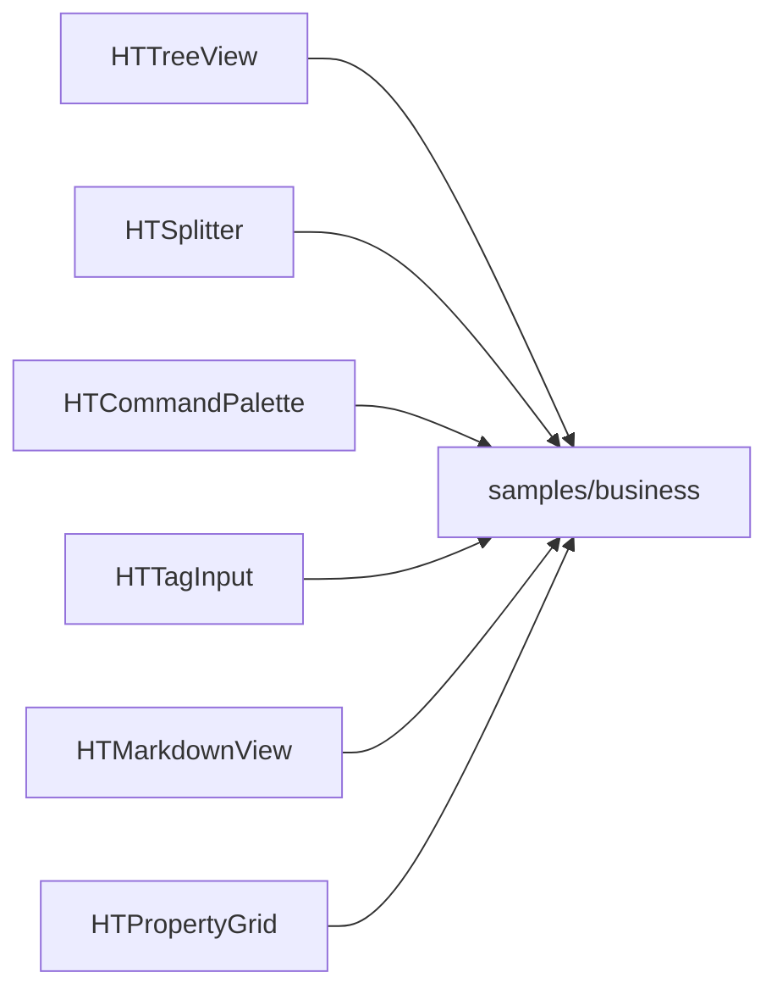

# Šest vidžeta za poslovne ekrane

Biblioteka ima šest klasa u `src/HTWidget/`. `hbtui.hbp` uzima `src/HTWidget/*.prg`, pa novi fajl ulazi u biblioteku sam. Boje se ne dodaju: `HT_CLR_MAX` ostaje 59, a vidžeti uzimaju postojeće kategorije (lista, okvir, meni, polje, browse). Time `test_theme` i ugrađene teme ostaju netaknute.

Konstante: `HT_SPLIT_*`, `HT_MD_*`, `HT_PROP_*` u [include/hbtui.ch](../include/hbtui.ch).

CNC, CBro, CEdit i CuiBuilder se u ovom koraku ne prepravljaju. Prelazak tih programa na nove klase je poseban korak.

## Redosled

Nema međusobne zavisnosti u kodu. Paleta i tagovi ponavljaju obrazac iz HTSearchBox (filter). Tabela osobina ima ugrađene editore po `HT_PROP_*` tipu.

## Zajedničko

- Logika tastature u `handleKey()` — testabilna headless, bez prozora.
- Tekst na ekranu preko `ht_strWidth()` / `ht_glyph()`, nikad CP437 bajtova kroz `DispOutAt`.
- Skrol: `nTop` / `Ftop`, točkić miša gde ima smisla.
- Miš: `childAt()` ulazi u vidžet bez svog prozora. Ručica splitera dobija klik; deca u panelima svoja.

## 1. HTTreeView

Fajl [src/HTWidget/HTTreeView.prg](../src/HTWidget/HTTreeView.prg). Čvor nije vidžet: `HTTreeNode` (tekst, `userData`, roditelj, deca, `expanded`).

- `addNode( cText, oParent, xUser )`, `expand()` / `collapse()` / `toggle()` / `expandAll()`, `currentNode()`, `findData( xUser )`.
- `onChanged`, `onActivated`, `onExpanded`.
- Vidljivi redovi se sklapaju iz otvorenih čvorova (`rowText( n )`, `rowCount()`).
- Tastatura: gore/dole, desno otvara ili ulazi, levo zatvara ili ide na roditelja, Space menja otvoreno, Enter aktivira, tipka skoči na prvo slovo.
- Miš: klik na `[+]`/`[-]` menja čvor, klik na natpis bira, dupli klik aktivira.
- Crtanje: `ht_glyph()` za `├──` `└──` `│`. Boje `HT_CLR_LIST_*`.

## 2. HTSplitter

Fajl [src/HTWidget/HTSplitter.prg](../src/HTWidget/HTSplitter.prg). Vidžet, ne layout: slaže N panela sa ručicama između.

- `HT_SPLIT_VERTICAL` (│, levo–desno) ili `HT_SPLIT_HORIZONTAL` (─, gore–dole).
- `addWidget( oPane )`, `setSizes( { nCells, ... } )`, `sizes()`, `setMinimum( nCells )`, `moveHandle( n, nDelta )`, `widget( n )`.
- Ručica je jedna ćelija. `mouseDragWanted()` je `.T.` dok je dugme pritisnuto na ručici.
- Fokus na ručici, strelice pomeraju; Shift za veći korak.
- Boja ručice `HT_CLR_FRAME`, pod mišem `HT_CLR_MENU_ITEM_SEL`.

## 3. HTCommandPalette

Fajl [src/HTWidget/HTCommandPalette.prg](../src/HTWidget/HTCommandPalette.prg). Nije stalni vidžet na formi.

- `addCommand( cTitle, bAction, xShortcut, cDetail )` ili `addMenus( oBar )` (stavke iz `HTMenuBar`).
- `exec()` otvara modalni dijalog (polje + lista). Enter pokreće označenu komandu posle zatvaranja; Esc zatvara bez akcije.
- Filter kao search box (latinica → ćirilica). Desno od imena: prečica.
- Aplikacija veže taster (`win:onKey( K_CTRL_P, … )` ili `setShortcut`). Paleta ne uzima Ctrl+P globalno.

## 4. HTTagInput

Fajl [src/HTWidget/HTTagInput.prg](../src/HTWidget/HTTagInput.prg).

- `tags()` / `setTags( a )`, `addTag()` / `removeTag()`, `onChanged( aTags )`.
- `setSuggestions( aItems )`: kucanje sužava listu; Down/Enter uzima predlog.
- Enter ili zarez na tekstu dodaje tag. Backspace na praznom polju skida poslednji. Klik na `×` skida taj.
- Crtanje: `[Plaćeno ×]` + polje. Boja taga `HT_CLR_BUTTON_NORMAL`.

## 5. HTMarkdownView

Fajl [src/HTWidget/HTMarkdownView.prg](../src/HTWidget/HTMarkdownView.prg). Prikaz, ne editor.

- `setMarkdown( c )` parsira i prelama (`setWrapWidth( n )`, `ht_strWidth`).
- Naslovi `#` `##` `###`, `**bold**`, `*italic*`, liste, `` `code` `` / fenced, link `[tekst](url)`, citati, `---`, `|` tabele.
- `lineText` / `lineKind` / `spanKind` / `linkAt`; `onLink` na klik. Skrol tastaturom i točkićem.
- Boje preko postojećih tema (title, label, hotkey, readonly) + `HT_MD_*` vrste.

## 6. HTPropertyGrid

Fajl [src/HTWidget/HTPropertyGrid.prg](../src/HTWidget/HTPropertyGrid.prg). Dve kolone, Osobina | Vrednost.

- `addProperty( cName, cLabel, cType, xValue [, aChoices ] )` sa
  `HT_PROP_TEXT` / `NUMBER` / `LOGICAL` / `LIST` / `COLOR` / `FILE`.
- `addGroup( cTitle )` je zaglavlje (nije editabilno). `value` / `setValue`, `onChanged( cName, xValue )`.
- Tekst i broj: kucanje + Enter. Logičko: Space. Lista i boja: Left/Right. Fajl: F4 ili `onBrowse`.
- `setNameWidth( n )`, `setReadOnly( cName, l )`. Boje browse / get.

## Primer i provera

- [samples/business/business.prg](../samples/business/business.prg): `HTMainWindow` sa vertikalnim spliterom (stablo | desna strana), horizontalnim spliterom (tagovi, osobine, markdown), paleta na Ctrl+P.
- Testovi u `test_widgets.prg`: stablo, spliter (2 i 3 panela), markdown, tagovi, paleta, property grid.
- Gradnja: `hbmk2 hbtui.hbp`; `cd tests && hbmk2 test_widgets.prg hbmk.hbm && test_widgets`; `cd samples/business && hbmk2 business.prg hbmk.hbm`.
- Hijerarhija i API u [CLAUDE.md](../CLAUDE.md); red u tabeli primera u [README.md](../README.md).
