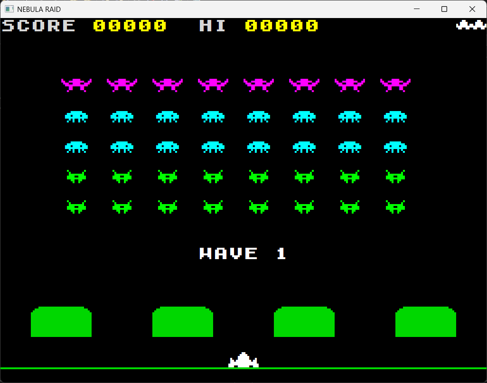

# NEBULA RAID

> **A retro fixed-screen shooter built in text mode using the [Harbour-CUI](https://github.com/digikv/Harbour-CUI) library.**



---

## 🕹️ A Tribute to Childhood, Tokens, and "Martians"

Back in the 1980s, before home computers became common in living rooms, the real world of video games lived inside local arcade clubs (*fliperane* in former Yugoslavia, *fliperamas* in Brazil). We used to stand in line with friends, clutching one or two precious tokens in our hands, gathered around massive, heavy wooden cabinets with dim, glowing CRT screens.

In our local slang, we didn't play *Space Invaders*. We played **"Martians"** (*"Marsovci"* — or *"Marcianitos"* across Latin America). Everything came down to pure reflex, unmistakable electronic bleeps from a single mono speaker, a worn-out joystick, and that one fire button built to survive thousands of hits a day. Clearing each wave was a small victory in front of the crowd watching over your shoulder, and typing your three initials at the top of the *High Score* table meant neighborhood glory—at least until tomorrow.

**Nebula Raid** is my small digital bow to those days, those machines, and the neighborhood crew—as well as a practical showcase of how far text mode can go with **Harbour-CUI**.

---

## 🛠️ How It Works (Harbour-CUI Showcase)

This sample demonstrates several low-level and visual capabilities of `Harbour-CUI`:

* **True 8-Bit Architecture (`256 × 192` pixels):** The screen is a `32 × 24` character grid where every sprite is a custom `8 × 8` pixel glyph (`nebula8.ttf` on Windows, X11 bitmap fonts on Linux), mapped to the Unicode *Private Use Area* (`U+E000`). It replicates the exact way 8-bit home computers operated using redefined character sets.
* **Runtime Font Loading (`ht_fontLoad`):** Loads the custom font strictly for the duration of the process without requiring system-wide font installation.
* **Custom 16-Color Retro Palette:** Redefines the standard GT color palette to match classic 8-bit home computer luminance levels (84% standard, 100% bright).
* **Arcade-Grade Input (`ht_keyDown`):** Bypasses standard terminal key-repeat delays by reading real-time held key states, enabling smooth simultaneous movement and firing (with an `Inkey()` frame-counter fallback on unsupported platforms).
* **Sub-Cell Projectile Precision:** Player shots and alien bombs move in half-row increments using dedicated upper/lower cell glyphs for smoother vertical motion.
* **Arcade Sound Without Stalls:** Square-wave and noise effects (laser, explosions, comet, the formation's four-note heartbeat) are synthesized at start as 8-bit WAV images and played asynchronously (`PlaySound` from memory on Windows, `aplay` elsewhere) - `Tone()` would freeze the game for every beep.
* **High Score Table:** The top five scores with three initials, entered the arcade way, are kept in `nebula.hi` next to the program (in a read-only folder: `%APPDATA%\nebula.hi` on Windows, `~/.nebula.hi` on Linux). A game left with Esc does not count.

## 👾 Gameplay

* Aliens are hit across their whole width (both cells).
* From wave 3, mantas break formation and dive at the player (Galaxian style), dropping bombs; shot while diving they are worth 60. One that misses comes back from the top to its place.
* After each wave, every bunker cell gets one step of wear repaired.
* An extra life every 5,000 points (up to 6).
* Held down, the ship speeds up after a third of a second; a tap still moves exactly one cell.
* A slowly drifting starfield in two layers, with twinkling near stars.

---

## 🎮 Controls

| Key | Action |
| :--- | :--- |
| **Left / Right** or **Z / X** | Move ship left / right |
| **Space** or **Up Arrow** | Fire laser |
| **P** | Pause / Resume game |
| **S** | Sound on / off |
| **Alt + Enter** | Toggle fullscreen (Windows) |
| **Esc** | Quit to title / Exit |

---

## 🚀 Building & Running

### Download

Ready to play, no build needed: **[Nebula Raid 1.0 release](https://github.com/digikv/Harbour-CUI/releases/tag/nebula-raid-1.0)**

| File | Platform |
|---|---|
| `nebula-raid-1.0-win32.zip` | Windows: `nebula.exe` + `nebula8.ttf` (keep them together) |
| `nebula-raid-1.0-linux-x86_64.tar.gz` | Linux x86_64 (X11): `nebula` + the `x11/` fonts; needs `libx11-6`, sound needs `aplay` (alsa-utils) |

### Build

Make sure you have [Harbour](https://harbour.github.io) installed and the `Harbour-CUI` library built
(`hbmk2 hbtui.hbp` in the repository root). Then, in `samples/game`:

```bash
hbmk2 nebula.prg hbmk.hbm
```

Keep `nebula8.ttf` (Windows) or the `x11/` folder (Linux) next to the program. On Linux the program
links Xlib (`-lX11`, in `hbmk.hbm`; package `libx11-dev`).

### Customizing Graphics
All sprites are defined in `nebula.glyphs` and compiled into `nebula8.ttf` and the `x11/` bitmap font directory using `ht_glyphsBuild()` (via `samples/fonteditor` or `tools/pixelfont`).

---

## 🇷🇸 Omaž detinjstvu, žetonima i „Marsovcima”

Osamdesetih godina prošlog veka, pre nego što su kućni računari postali svakodnevica, pravi svet video-igara živeo je u lokalnim fliperanama i klubovima za igranje. Stajali smo u redu sa društvom, stežući u ruci jedan ili dva dragocena žetona, okupljeni oko ogromnih, teških drvenih automata sa zatamnjenim CRT ekranima.

U našem žargonu, nismo igrali *Space Invaders*. Igrali smo **„Marsovce”**. Sve se svodilo na čist refleks, prepoznatljive elektronske tonove iz mono zvučnika, izlizani džojstik i ono jedno dugme za pucanje koje je moralo da izdrži hiljade udaraca dnevno. Svaki pređeni talas bio je mala pobeda pred publikom koja ti stoji iza leđa, a upisivanje tri slova na vrh *High Score* liste značilo je slavu u kraju bar do sutradan.

**Nebula Raid** je moj mali digitalni naklon tom vremenu, tim mašinama i društvu iz kraja — ali i praktičan prikaz mogućnosti tekstualnog režima u **Harbour-CUI** biblioteci.
